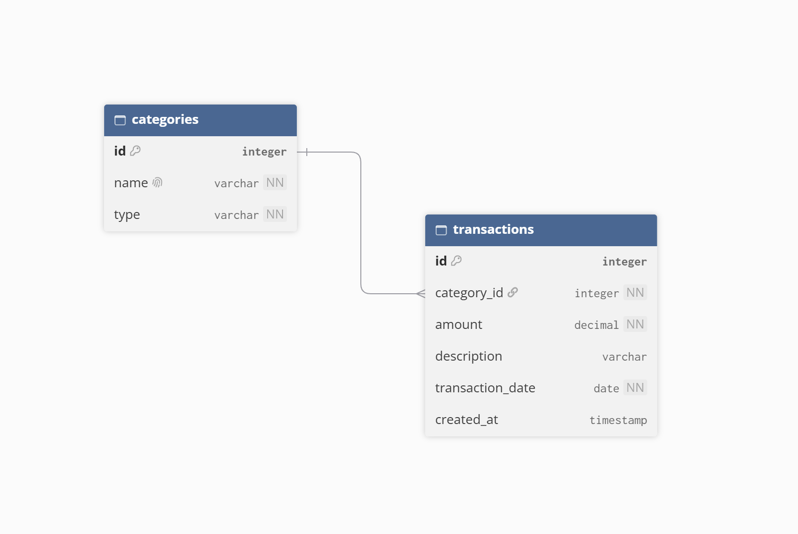
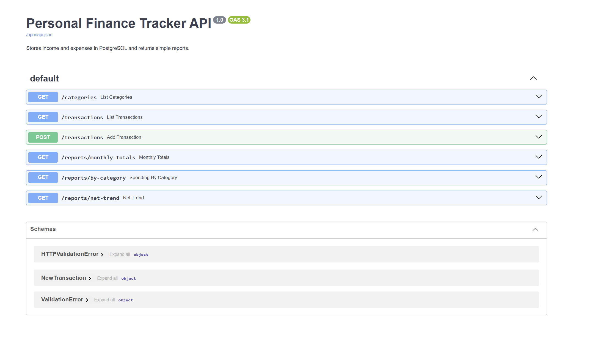
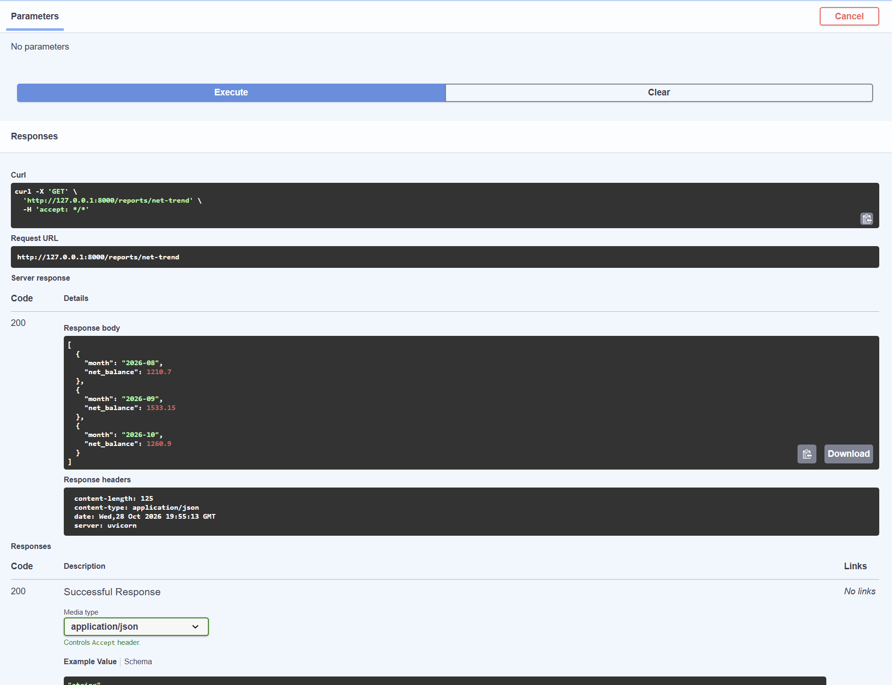
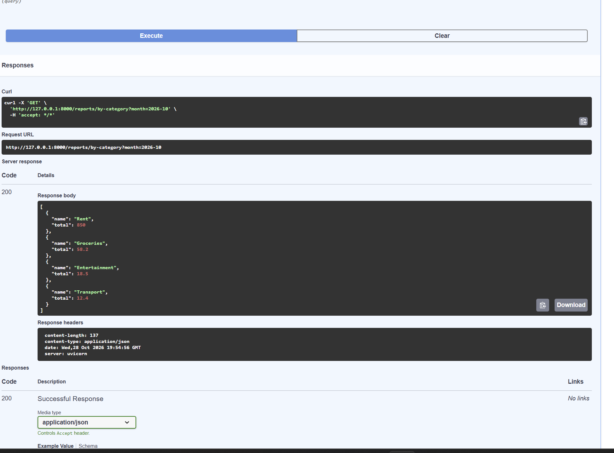
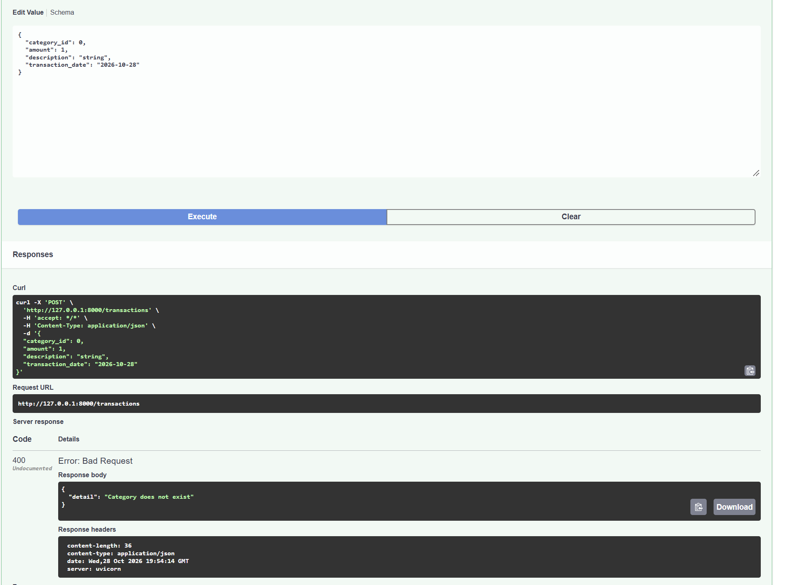
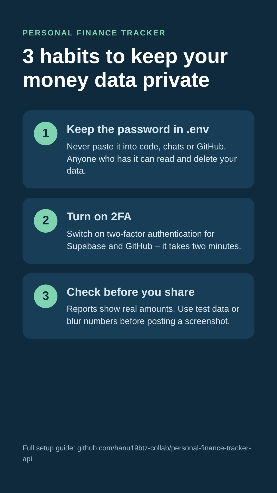

# Personal Finance Tracker API

A back-end that stores personal income and expenses in a **PostgreSQL** database (hosted on **Supabase**) and returns simple reports through a **FastAPI** web API – monthly totals, spending by category and the net balance trend.

Built as the mini-project for **PFD200 Professional Development** (FdSc Computing) to close a skills gap in **relational database design, SQL and connecting a database to an application**.

> ### 🔐 Before you start – 3 habits to keep your money data private
> 1. **Your database password lives only in `.env`.** Never paste it into the code, a chat or GitHub.
> 2. **Turn on two-factor authentication** for your Supabase and GitHub accounts.
> 3. **Check before you share.** Screenshots and reports show real amounts – use test data or blur them first.

## Tech stack
| Layer | Tool |
|---|---|
| Database | PostgreSQL on Supabase (free tier) |
| API | Python, FastAPI, psycopg |
| Design | dbdiagram.io (ERD) |
| Project management | Jira (Scrum, 2 sprints) |

## Database design
One category has many transactions (one-to-many). `transactions.category_id` is a **foreign key** to `categories.id`.



| Table | Key columns | Rules |
|---|---|---|
| `categories` | `id` (PK), `name`, `type` | `name` unique; `type` must be `income` or `expense` |
| `transactions` | `id` (PK), `category_id` (FK), `amount`, `transaction_date` | `amount` > 0; category must exist |

SQL scripts are in [`/sql`](sql):
1. `01_schema.sql` – creates the tables, constraints and Row Level Security
2. `02_test_data.sql` – 6 categories and 15 transactions (Aug–Oct 2026)
3. `03_reports.sql` – the three reporting queries
4. `04_constraint_tests.sql` – tests that the database rejects invalid data

## API endpoints
| Method | Endpoint | Returns |
|---|---|---|
| GET | `/categories` | All categories |
| GET | `/transactions` | All transactions with their category |
| POST | `/transactions` | Adds a transaction (validated) |
| GET | `/reports/monthly-totals` | Income vs expenses per month |
| GET | `/reports/by-category?month=2026-10` | Spending per category for a month |
| GET | `/reports/net-trend` | Net balance per month |

Interactive documentation: `http://127.0.0.1:8000/docs`

## How to run
1. Create a Supabase project and run the scripts in `/sql` (01 and 02) in the SQL Editor.
2. Clone this repository and install the packages:
   ```
   pip install -r requirements.txt
   ```
3. Copy `.env.example` to `.env` and paste your Supabase connection string (**Connect → Session pooler**).
4. Start the API:
   ```
   uvicorn main:app --reload
   ```
5. Open `http://127.0.0.1:8000/docs`.

## Testing
| Test | Expected | Result |
|---|---|---|
| Insert a transaction with a category that does not exist (99) | Rejected by the foreign key | ✅ Pass |
| Insert a negative amount | Rejected by the CHECK constraint | ✅ Pass |
| Monthly totals report | Aug 2200.00 / 989.30, Sep 2500.00 / 966.85, Oct 2200.00 / 939.10 | ✅ Pass |
| Spending by category (Oct) | Rent 850.00, Groceries 58.20, Entertainment 18.50, Transport 12.40 | ✅ Pass |
| Net balance trend | Aug 1210.70, Sep 1533.15, Oct 1260.90 | ✅ Pass |
| `POST /transactions` with unknown category | HTTP 400 "Category does not exist" | ✅ Pass |
| `POST /transactions` with negative amount | HTTP 422 validation error | ✅ Pass |

## Security
- **Row Level Security** is enabled, so the tables cannot be read through Supabase's public API key.
- The database password is stored only in a local `.env` file, which is excluded from GitHub by `.gitignore`.
- The API has **no user authentication** (out of scope for this project) and is meant to run locally only.

## Screenshots
**Interactive API documentation (`/docs`)**



**Net balance trend – live data from Supabase**



**Spending by category (October 2026)**



**Validation – a transaction with a non-existent category is rejected**



**Security awareness card for users**



## Author
Claudiu Hanu – FdSc Computing
